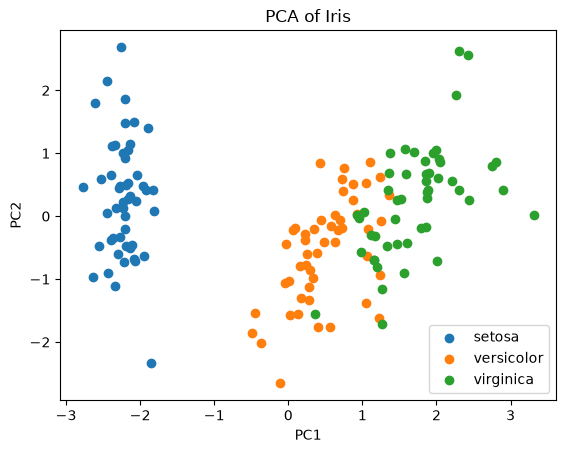
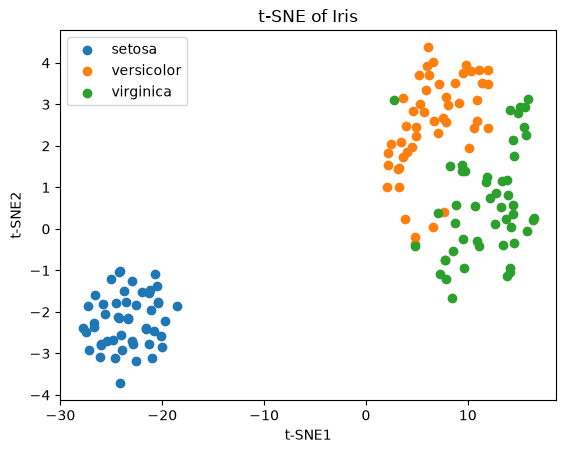

# PCA and t-SNE on the Iris Dataset

I reduced the Iris dataset to two dimensions with PCA and with t-SNE and compared the results. The data is scikit-learn's built-in Iris set, standardized before either method ran. Two principal components keep 95.8% of the variance in the scaled data (73.0% on PC1, 22.9% on PC2). t-SNE showed clearer clusters but offers no number like that.



*PC1 alone carries 73.0% of the variance, so most of the spread runs left to right.*

## What I did

- Scaled every feature with `StandardScaler`, because PCA picks the directions of largest variance and an unscaled feature with a wide range would dominate the first component.
- Fit `PCA(n_components=2)` and printed the explained variance ratios, which say how much a two-dimensional plot leaves out.
- Ran `TSNE(n_components=2, random_state=42, perplexity=30)` on the same scaled data. The seed is fixed because t-SNE is stochastic, and without it the plot changes from run to run.

## Results

| Measure (on standardized Iris) | Value |
|---|---|
| Variance explained by PC1 | 73.0% |
| Variance explained by PC2 | 22.9% |
| Variance kept by PC1 and PC2 together | 95.8% |
| t-SNE settings | 2 components, perplexity 30, random_state 42 |
| Explained variance for t-SNE | none; the method does not define one |

That makes the PCA plot a faithful flat view of the data. t-SNE keeps local neighborhoods rather than global distances: its clusters look cleaner, but the gaps between them do not mean what gaps in the PCA plot mean.



*Same data with t-SNE at perplexity 30: cleaner clusters, but the axes have no units and gaps between clusters are not measurements.*

## What I learned

- The t-SNE picture looks better and is harder to defend. It can exaggerate separation, and the features a reduction drops may be the ones that matter most for a small group in the data. For a report I would show the PCA plot with its 95.8% beside it.
- I used one perplexity and one seed, on a dataset picked for its simplicity. Next step: rerun at several perplexities and seeds and see how much the picture moves.

## How to run

```bash
git clone https://github.com/drewmenning/week3-dimensionality-reduction.git
cd week3-dimensionality-reduction
pip install numpy matplotlib scikit-learn jupyter
jupyter notebook dimensionality_reduction.ipynb
```

Run the cells in order, locally or in Google Colab. Iris loads through scikit-learn's `load_iris`, so there is no separate data file. The original .ipynb was plain text, not notebook JSON, so GitHub could not render it. I rebuilt it as a real notebook with the same text and code, restoring only the indentation that two for-loops had lost. Outputs are from a clean run on October 14, 2026 on Python 3.13.16.

## Files

- [dimensionality_reduction.ipynb](dimensionality_reduction.ipynb): the notebook (code, saved outputs, method notes, ethical reflection).
- `images/pca-iris.png`: the PCA plot.
- `images/tsne-iris.png`: the t-SNE plot.
- `README.md`: this file.

*Module 3 coursework for the AAS in Artificial Intelligence at DMACC, spring 2026.*
