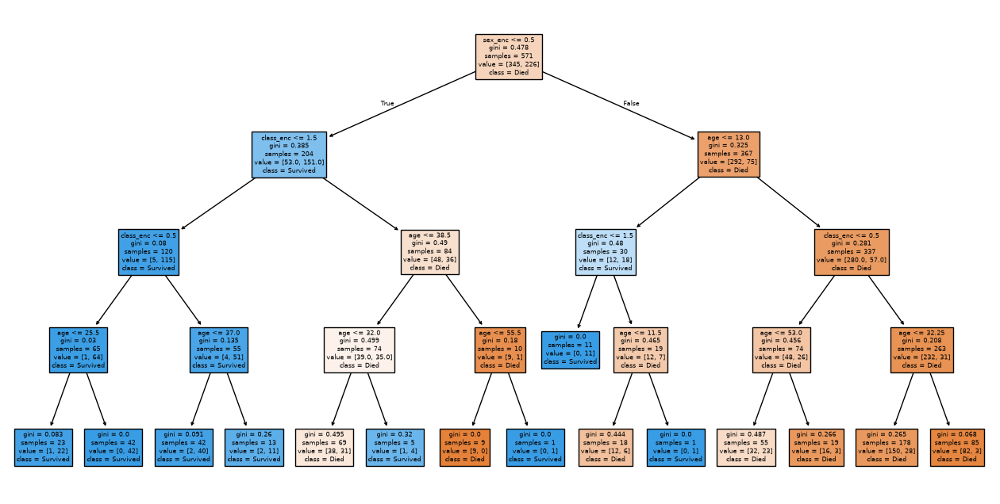

# Probability, Naive Bayes and Decision Trees on Titanic Survival

After a warm-up on coin flips and conditional probability, I built two small classifiers that predict who survived the Titanic from sex, age and passenger class. The data is the Titanic table that seaborn downloads. On the same 20% test split, Gaussian Naive Bayes reached 80.4% accuracy and a depth-4 decision tree reached 77.6%, so the simpler model won.



*The depth-4 tree. Each box shows how many training passengers reached it and which class it predicts, and the split boxes also show the rule.*

## What I did

- Part A: 1,000 simulated runs of 10 fair coin flips (numpy, seed 0); exactly 5 heads came up 24.5% of the time. On the Titanic table, 74.2% of female passengers survived, and female passengers make up 68.1% of all survivors. The two numbers sound alike and answer different questions.
- Prep: I dropped passengers missing sex, age, class or survived and label-encoded sex and class. The split is 80/20 with random_state=0, so both models face the same test passengers.
- Part B: Gaussian Naive Bayes on those three features.
- Part C: a decision tree with max_depth=4, which keeps the plot readable and limits how finely it can split the passengers.
- Part D: a written reflection on where these models can mislead and how to explain uncertainty to a non-technical reader.

## Results

| Model | Test accuracy | Correct of 79 who died | Correct of 64 who survived |
|---|---|---|---|
| Gaussian Naive Bayes | 80.4% | 68 | 47 |
| Decision tree, max_depth=4 | 77.6% | 75 | 36 |

The gap is four passengers out of 143 (115 right against 111). The error pattern differs more than the totals. The tree sent only 4 of the 79 who died to the survived side but called 28 of the 64 survivors dead. Naive Bayes spread its mistakes more evenly: 11 of the 79 who died and 17 of the 64 survivors. Sex carried 0.556 of the tree's feature importance, class 0.294 and age 0.150.

## What I learned

- Gaussian Naive Bayes treats the encoded sex and class columns as bell-shaped measurements, which they are not. A Naive Bayes variant built for categories is the first thing I would try next.
- One random split of 143 test passengers with no cross-validation means a 2.8 point gap could flip with a different random_state.
- Part D's reflection says predictions are estimates, not guarantees. The tree's own errors show why: it predicted death for 103 of the 143 test passengers when only 79 died.

## How to run

The Titanic table downloads through seaborn's `load_dataset`, so you need an internet connection. The coin flips come from numpy, so there is no data folder.

```bash
pip install numpy pandas matplotlib seaborn scikit-learn notebook
jupyter notebook probability-bayes-decision-trees.ipynb
```

Run all cells from the top. The saved outputs come from a clean run on October 14, 2026 with Python 3.13, scikit-learn 1.9.1 and seaborn 0.13.2.

## Files

- [probability-bayes-decision-trees.ipynb](probability-bayes-decision-trees.ipynb): the notebook, Parts A to D, with saved outputs.
- `images/decision-tree.png`: the tree plot from Part C.
- `README.md`: this file.

*Module 6 coursework for the AAS in Artificial Intelligence at DMACC, spring 2026.*
