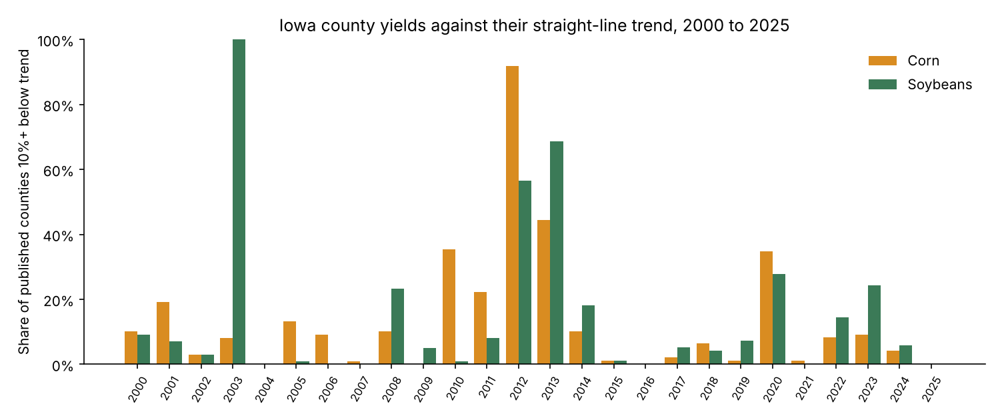
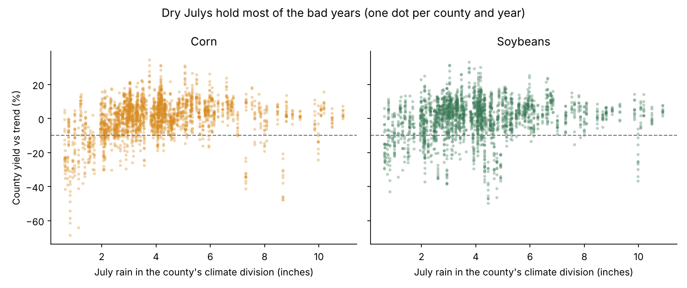
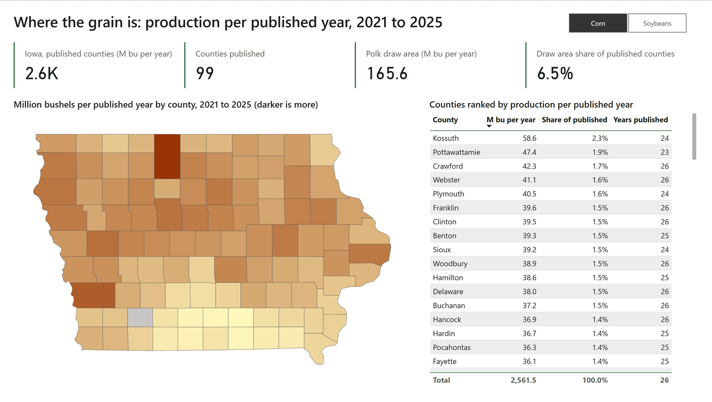

# Iowa County Corn and Soybeans in SQL: Where the Grain Is, and Which Years Went Wrong

I joined USDA NASS county estimates for corn and soybeans (all 99 Iowa counties, 2000 to 2025) to daily weather from the Iowa Environmental Mesonet, loaded both into a SQLite star schema, and answered the questions a grain elevator manager would ask with six SQL queries. The worst corn year in the data is 2012: 91 of 99 counties came in 10% or more below their own straight-line trend, the median county was 25% below, and July rain in those counties' climate divisions averaged 1.2 inches against 4.1 inches in a typical July. For soybeans the worst year was 2003, when every one of the 99 counties missed trend by 10% or more. Across all 4,907 county-years, bad corn years averaged 2.8 inches of July rain and 24 days at 90F or hotter; normal years averaged 4.3 inches and 13.5 days.



*Share of published counties at least 10% below their straight-line yield trend, by crop and year. The trend is fit per county and crop in SQL. Source: `data/outputs/04_trend_residual_bad_years.csv`.*

## What I did

- **Pulled from the primary sources, no API key needed.** `src/nass_pull.py` streams NASS's full Quick Stats crops file (1.1 GB compressed) and keeps the Iowa corn and soybean survey rows. In my run that was 48,010 rows out of 23.9 million lines, in 90 seconds on a home connection. `src/iem_pull.py` pulls daily high, low, rain and growing degree days for the nine Iowa climate divisions from the IEM's Climodat endpoint. `src/lookups_pull.py` gets NCEI's county-to-climate-division map. The filtered extracts are committed, so the pipeline runs from a clone without the download.
- **Cleaned to one row per county, crop and year** with planted acres, harvested acres, yield and production. NASS folds thin-data counties into an "OTHER (COMBINED) COUNTIES" row in recent years; I drop those rows rather than guess, which is why 2024 has 73 corn counties published instead of 99. `docs/validation.md` tracks how much of the state total the published counties cover each year (100% in 2000, 75% for corn in 2024).
- **Summarized weather by growing season**, April through September, per division and year: total rain, July rain, growing degree days (base 50), and days with a high of 90F or more. Counties join to weather through their district. I checked that NASS's nine agricultural districts and NCEI's nine climate divisions contain the same 99 counties, and they do.
- **Built a star schema in SQLite** (`sql/schema.sql`): `dim_county`, `dim_crop`, `fact_crop_county_year`, `fact_crop_state_year` and `fact_weather_district_season`, plus a view, `v_yield_trend`, that fits a straight-line yield trend per county and crop with sums inside SQL. `src/load_sqlite.py` loads it.
- **Wrote six analytic queries**, one per manager question, in `sql/analysis/`: production per published year with a window `SUM` and `RANK`; crop mix shift with `LAG`; a five-row rolling yield with a `ROWS BETWEEN` frame; every county-year scored against its trend; weather in bad versus normal years; and expected 2026 bushels for the elevator's draw area. `src/run_queries.py` exports each result to `data/outputs/`, and `src/summary.py` builds the tables quoted below from those exports.
- **Checked the work.** `src/validate.py` compares the county sums to the state figure and checks that harvested acres never exceed planted and that production equals harvested acres times yield. It also refits three counties' trends with NumPy to confirm the SQL math. Ten pytest checks cover the cleaning rules and the query outputs.
- **Made it readable.** A four-page Plotly dashboard (`dashboard/iowa_crops_dashboard.html`), a four-page Power BI report, four figures, a data dictionary and a one-page memo written for an elevator manager in the Polk County draw area.

## Results

Worst years by crop, from `data/outputs/summary_worst_years.csv`. July rain and hot days are averaged over the counties published that year, each county taking its own climate division's value.

| Crop | Year | Counties 10%+ below trend | Median county vs trend | July rain (in) | Days 90F+ |
|---|---|---|---|---|---|
| Corn | 2012 | 91 of 99 | -25.0% | 1.2 | 39.9 |
| Corn | 2013 | 44 of 99 | -8.8% | 1.7 | 17.7 |
| Corn | 2010 | 35 of 99 | -4.8% | 7.8 | 10.6 |
| Corn | 2020 | 33 of 95 | -5.9% | 3.1 | 17.9 |
| Soybeans | 2003 | 99 of 99 | -28.5% | 4.1 | 15.7 |
| Soybeans | 2013 | 68 of 99 | -14.8% | 1.7 | 17.7 |
| Soybeans | 2012 | 56 of 99 | -11.8% | 1.2 | 39.9 |

Weather in bad versus normal county-years, from query 05 (a bad county-year is 10% or more below trend):

| Crop | Year type | County-years | July rain (in) | Season rain (in) | Days 90F+ | Harvested / planted | Avg vs trend |
|---|---|---|---|---|---|---|---|
| Corn | bad | 338 | 2.84 | 23.0 | 24.0 | 0.960 | -20.2% |
| Corn | normal | 2,132 | 4.28 | 25.2 | 13.5 | 0.970 | +3.2% |
| Soybeans | bad | 376 | 3.06 | 22.2 | 19.5 | 0.993 | -19.7% |
| Soybeans | normal | 2,061 | 4.26 | 25.4 | 14.1 | 0.993 | +3.6% |

The draw area is Polk County plus the six counties that share a boundary with it in the Census county outlines (Boone, Dallas, Jasper, Marion, Story and Warren). Measured per published year over 2021 to 2025, it grows about 166 million bushels of corn a year, 6.5% of what NASS published for Iowa, and 42 million bushels of soybeans, 7.1%. Jasper is the largest producer in the area at 36 million bushels of corn a year, but NASS has not published it since 2023, which is why the queries report production per published year rather than a five-year sum. Corn's share of corn-plus-soybean planted acres in the area went from 51.5% in 2000 to a peak of 61.3% in 2007 and has run between 52.5% and 56.8% over 2021 to 2025. Query 06 puts the area's expected 2026 crop at 168 million bushels of corn and 40 million of soybeans on the latest published planted acres and each county's trend yield. Those are planning numbers for a trend year, with no weather in them.



*One dot per county and year. Most of the bad years sit on the dry side, but not all of them: 2010 was a wet year with 7.8 inches of July rain on average, and the 2003 soybean collapse came with a normal July.*

## Power BI report

I also built a four-page Power BI report on the same SQLite outputs. It is saved two ways: as a Power BI Project (PBIP, with the report in PBIR JSON files and the semantic model in TMDL) and as a single `powerbi/iowa-county-crop-ops.pbix` that opens with the data already loaded (import mode, about 330 KB).



*Page one in the corn view. The map shades each county by production per published year; the cards pull out the Polk draw area.*

| Page | What it answers | Main visuals |
|---|---|---|
| Where the grain is | Which counties grow the most, and how much of it sits in the Polk draw area | Four cards, shape map of all 99 counties, ranked county table, crop slicer |
| County yield vs trend | How one county's yield tracks its trend line, and which years fell short | County dropdown, cards, actual vs trend line chart, year table |
| Bad years and weather | What July rain and heat looked like when counties fell 10% or more below trend | Column chart by year, bad-year weather table, July rain scatter, worst-years table |
| Elevator view | What the seven draw-area counties grew, and what 2026 might bring | Cards, corn share line, expected 2026 column chart, county table |

One modeling choice mattered more than the rest. Production is measured per published year, not as a five-year sum, because NASS stopped publishing some counties. Jasper has no county row after 2023, and only 73 corn counties were published in 2024. The DAX measure divides each county's production by the number of years it was published, then sums the counties. State share uses the published counties as the denominator, and the card label says so.

To open it, double-click the `.pbix` in Power BI Desktop. To work from the project instead, open `powerbi/iowa-county-crop-ops.pbip`, set the `DataFolder` parameter (Transform data > Edit parameters) to the `data` folder of your clone, then refresh. Table and measure details are in [docs/powerbi.md](docs/powerbi.md).

## What I learned

- **Published does not mean complete.** In 2000 the county rows add up to 100% of NASS's state production. By 2024 they cover 75% for corn and 69% for soybeans because NASS now combines small counties. Any "share of state" has to say which denominator it uses, and a five-year sum quietly punishes a county that is missing a year, so the production query averages per published year and reports how many years each county has.
- **Division weather has no gaps, and it hides local storms.** The IEM's division series are gridded averages, so every season here has all 183 days, but a storm that hit one county and missed its neighbors does not show. The spread in the scatter plot at any given July rainfall is partly that.
- **A linear trend is enough to find the bad years, and not enough to explain them.** The sums-based fit (`SUM((x - xbar) * (y - ybar)) / SUM((x - xbar) * (x - xbar))`) matched `numpy.polyfit` to the tenth of a bushel. Corn trends ran 1.4 to 3.3 bushels per acre per year across counties, soybeans 0.4 to 1.0. The 10% flag caught the 2012 drought cleanly, but it also flagged 2010, which was the opposite problem, and the 2003 soybean year, which a July-only weather watch would have missed. When July rain was under 2 inches with 20 or more days at 90F, 73% of corn county-years ended 10% or more below trend, but only 41% of soybean county-years did (`summary_july_rule.csv`). July rain is an early warning for corn, not a rule for everything.
- **Window frames count rows, not years.** `ROWS BETWEEN 4 PRECEDING AND CURRENT ROW` gives a five-row average even when a county is missing a year. My first version added a row count to catch that, which cannot work, since the count is five either way. The fix was a `years_spanned` column from `FIRST_VALUE`: 333 of the 4,907 windows stretch over six to ten calendar years, and Warren's 2025 corn average covers 2018 to 2025.
- **The NASS bulk file is the easier door.** The Quick Stats API needs a key and caps the rows per request. Streaming the daily bulk file through gzip and keeping one state's rows took 90 seconds and needs nothing but the file name, which the script reads off the datasets page.

## How to run

```
pip install -r requirements.txt
python run_all.py --no-pull
pytest
```

`--no-pull` uses the committed extracts in `data/raw/` and `data/lookups/` and runs in under a minute; run it before `pytest`, since the tests read the database and the query outputs it builds. `python run_all.py` without the flag re-pulls everything from NASS, the IEM and NCEI first (the NASS step streams about 1.1 GB). The dashboard opens from `dashboard/iowa_crops_dashboard.html` in any browser and loads Plotly from cdn.plot.ly, so it needs an internet connection. The outputs in `data/outputs/` are plain CSVs, so they also load straight into Power BI or Excel.

Data as pulled on October 15, 2026: the NASS file `qs.crops_20261015.txt.gz`, IEM Climodat through September 30, 2026, and NCEI's `county-to-climdivs.txt`. County crop estimates run through 2025 (NASS loaded the 2025 county rows on May 5, 2026). The state table also holds NASS's 2026 figures as loaded on October 9, 2026, which are still estimates.

## Files

- `run_all.py`: pull, clean, load, query, validate, summarize, figures, dashboard, in that order.
- `src/`: `nass_pull.py`, `iem_pull.py`, `lookups_pull.py`, `clean.py`, `draw_area.py`, `load_sqlite.py`, `run_queries.py`, `validate.py`, `summary.py`, `figures.py`, `build_dashboard.py`.
- `sql/schema.sql` (tables and the trend view) and `sql/analysis/01` to `06`, the six questions.
- `data/raw/`: the filtered NASS extract (15 MB) and the IEM daily file (7 MB). `data/processed/`: the clean tables. `data/outputs/`: one CSV per query, the coverage table and the summary tables. `data/lookups/`: county-to-division map, draw area, Iowa county outlines.
- `docs/data_dictionary.md`, `docs/validation.md`, `docs/memo_elevator_manager.md`, `docs/powerbi.md`, `docs/figures/`.
- `dashboard/iowa_crops_dashboard.html`: where the grain is, county yield versus trend, bad years and weather, and the elevator view.
- `powerbi/`: the Power BI report as a PBIP project (PBIR report, TMDL model) and a `.pbix` with the data already loaded.
- `tests/`: ten pytest checks.

## Sources

- USDA NASS, Quick Stats bulk datasets: https://www.nass.usda.gov/datasets/
- Iowa Environmental Mesonet, Climodat daily data: https://mesonet.agron.iastate.edu/request/coop/fe.phtml (dataset notes at https://mesonet.agron.iastate.edu/info/datasets/climodat.html)
- NCEI county-to-climate-division map: https://www.ncei.noaa.gov/pub/data/cirs/climdiv/county-to-climdivs.txt
- Iowa county outlines: the Census county boundaries file redistributed in the Plotly datasets repository, https://github.com/plotly/datasets (geojson-counties-fips.json), trimmed to Iowa.

*Portfolio project, October 2026.*
