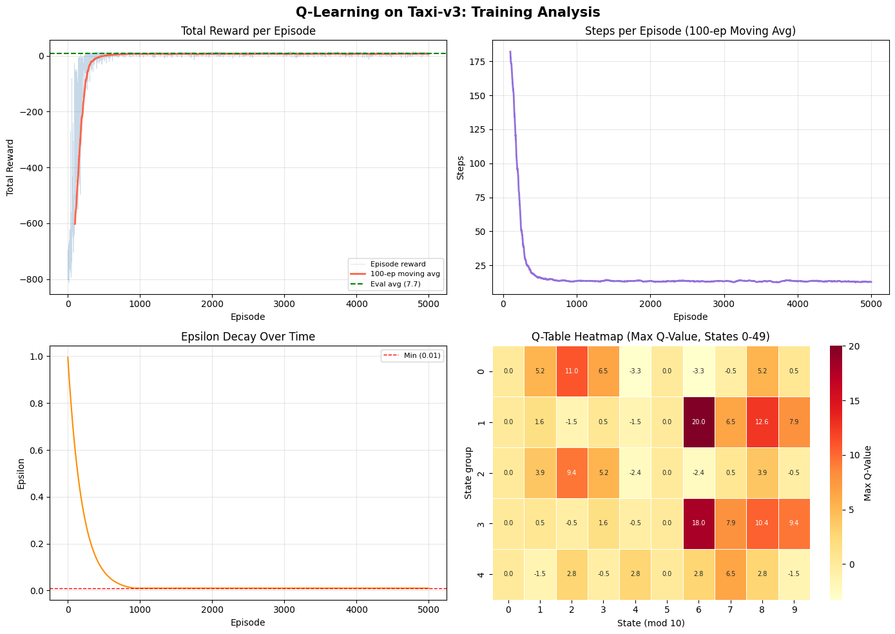
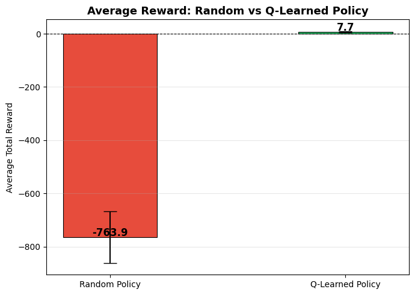

# Tabular Q-Learning on Taxi-v3

I wrote tabular Q-learning from scratch in NumPy and trained it on Gymnasium's Taxi-v3. The environment is a 5 by 5 grid where a taxi has to pick up a passenger and drop them off. After 5,000 training episodes the greedy policy made the correct drop-off on 200 of 200 evaluation trips, averaging 7.65 total reward and 13.35 steps per trip. A random policy averaged -763.90 over its own 200 episodes, so the learned policy scored 771.55 reward points higher. The surprise was timing: the 500-episode average reward was already positive by episode 1,000, far earlier than I expected.



*Top left: reward per episode with a 100-episode moving average and the greedy evaluation average as a dashed line. Top right: steps per episode, 100-episode moving average. Bottom left: epsilon decaying to its 0.01 floor. Bottom right: max Q-value for states 0 to 49.*

## What I did

- Taxi-v3 has 500 discrete states and 6 actions (four moves plus Pick Up and Drop Off). Reward is -1 per step and +20 for a correct drop-off, with -10 for an illegal pick-up or drop-off. Episodes are capped at 200 steps.
- I started a 500 x 6 Q-table at zero and coded the update by hand. After each step, `Q(s, a)` moves toward `r + gamma * max Q(s', a')` by a fraction alpha of the gap. On the last step of an episode the future term is dropped.
- Exploration is epsilon-greedy: epsilon starts at 1.0, is multiplied by 0.995 after every episode and stops at a 0.01 floor, which it had reached by episode 1,000.
- Settings: alpha 0.8, gamma 0.95, 5,000 training episodes. I chose a high alpha because Taxi-v3 is deterministic, so a big update is not chasing noise. In a stochastic environment I would lower it so one unlucky transition could not overwrite a good estimate.
- Evaluation: 200 greedy episodes (always the argmax action) plus 200 episodes of random actions for comparison. A trip counts as a success when it ends on the +20 reward.

## Results

| Measure (200 episodes each) | Random policy | Learned greedy policy |
|---|---|---|
| Average total reward | -763.90 | 7.65 |
| Standard deviation of total reward | 97.70 | 2.46 |
| Successful drop-offs | not tracked | 200 of 200 (100%) |
| Average steps per episode | not tracked | 13.35 |

During training, the average reward over each 500-episode block went from -172.04 (episodes 1 to 500) to 5.95 (episodes 501 to 1,000). Every later block landed between 7.04 and 7.67. The greedy evaluation average of 7.65 sits right on the 7.67 average of the last 500 training episodes. That fits: with epsilon at 0.01, almost every late training step was already greedy.



*Average total reward over 200 episodes each. Error bars show one standard deviation; the learned policy's bar is higher and far tighter.*

## What I learned

- Most of the learning happened far earlier than I thought. The reflection in the notebook says the moving average did not settle until around episode 3,000 to 4,000. The printed block averages disagree: the agent was already averaging 5.95 by episode 1,000 and was within a point of its final 7.67 by episode 1,500. Lesson: read the logged numbers before describing the plot.
- The 0.995 decay is fast for a 5,000-episode budget. Epsilon sat at its floor from episode 1,000 on, so the last 4,000 episodes ran almost fully greedy and lifted the block average only from 5.95 to 7.67. Next time I would try a slower decay or fewer episodes and compare.
- The run is not exactly reproducible. I seeded NumPy with 42 but not the environment resets in the training loop or the random action sampler, so a rerun will not match these numbers exactly.
- A lookup table only works because 500 states by 6 actions is small. A much larger state space would need a deep Q-network in its place.

## How to run

Taxi-v3 ships with Gymnasium, so there is nothing to download; `gym.make("Taxi-v3")` builds the environment. I ran the notebook in Google Colab on Python 3.10 with Gymnasium 1.2.3, and the first code cell installs Gymnasium. In Colab, upload the notebook and choose Runtime, then Run all. Locally:

```bash
pip install gymnasium numpy matplotlib seaborn
jupyter notebook rl_qlearning_assignment.ipynb
```

## Files

- [rl_qlearning_assignment.ipynb](rl_qlearning_assignment.ipynb): the assignment notebook, Parts A to D (explore the environment, train, evaluate, reflect).
- [images/training-analysis.png](images/training-analysis.png): the four training panels shown above.
- [images/random-vs-trained.png](images/random-vs-trained.png): the random vs learned policy bar chart.
- README.md: this write-up.

*Module 9 coursework for the AAS in Artificial Intelligence at DMACC, spring 2026.*
