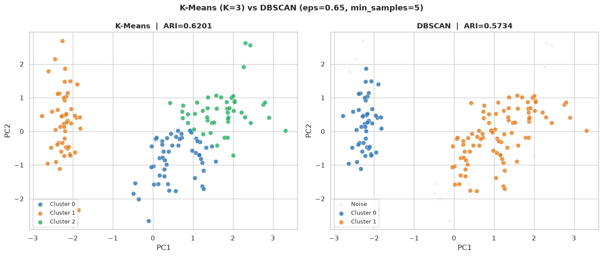

# Clustering the Iris Dataset with K-Means and DBSCAN

I clustered the Iris dataset with K-Means and DBSCAN and scored both against the true species using the adjusted Rand index (ARI). Iris is 150 flowers with four petal and sepal measurements each, 50 from each of three species. K-Means with K=3 reached an ARI of 0.62. DBSCAN stopped at 2 clusters, because versicolor and virginica run together at about the same density. It scored 0.57 with its 14 noise points set aside.



*Left: K-Means splits the versicolor and virginica overlap into two clusters. Right: DBSCAN keeps it as one cluster and marks 14 borderline points as noise (gray x marks).*

## What I did

- I looked at the pair plot first. Petal length and width separate setosa on their own and track each other closely. Sepal width overlaps across all three species and is the least useful feature by itself.
- I standardized the four features with `StandardScaler` first, because both algorithms work on distances and a feature with a wider spread would otherwise carry more weight.
- PCA with 2 components is for the plots only, and those two components keep 95.8% of the variance. Every clustering run used all four scaled features.
- For K-Means I checked inertia and silhouette for K from 2 to 7 (`n_init=10`, seed 42) and picked K=3 to match the three species. ARI is the score because it does not care which cluster gets which number.
- For DBSCAN I read eps off the knee of a k-distance plot (k=5), which landed near 0.65. A 3 by 3 grid over eps (0.4, 0.65, 1.0) and min_samples (3, 5, 10) showed how touchy the result was, and eps=0.65 with min_samples=5 was the best balance. At eps=0.4 DBSCAN broke the data into 2 to 10 small clusters and called 39 to 118 of the 150 flowers noise. At eps=1.0 it found the same two groups as eps=0.65 (setosa and everything else) with only 1 to 4 noise points.

## Results

| Method | Setting | Clusters found | Noise points | ARI vs true species |
|---|---|---|---|---|
| K-Means | K=3 | 3 | 0 (no noise label) | 0.6201 |
| DBSCAN | eps=0.65, min_samples=5 | 2 | 14 (9.3%) | 0.5734 (noise excluded) |

Both methods separate setosa cleanly, so the whole gap between them is in the versicolor and virginica overlap. K-Means forces a split there because I told it K=3, while DBSCAN sees one dense region and leaves it alone. K-Means at K=2 gives the same picture DBSCAN did: setosa alone and the other two species lumped together. Past K=3 it starts splitting setosa in two (28 and 22 flowers at K=4), and silhouette keeps dropping.

## What I learned

- I knew there were three species before I picked K. The elbow plot bends at K=3, but silhouette scores K=2 highest (0.582 against 0.460), because setosa sits so far from the other two. Without labels I could easily have picked 2, and there would be no ARI to check it.
- DBSCAN's lower score is not a failure of the method. Iris is three equal-sized, roughly round groups, which suits K-Means. The two that overlap have about the same density at the settings I tried, so DBSCAN had nothing to split on. I would expect it to do better on odd-shaped groups or real outliers, but nothing in this notebook tests that.
- At eps=0.4 with min_samples of 3 or 5, DBSCAN did pull versicolor and virginica into separate small clusters, but only by calling 39 or 66 of the 150 flowers noise. None of the nine settings gave a usable three-species split.
- Scoring DBSCAN only on the points it kept is generous, since the 14 it dropped are the borderline ones. Next time I would also score it with noise as its own group, so both methods are judged on the same 150 points.

## How to run

The data comes from `sklearn.datasets.load_iris`, which ships inside scikit-learn, so there is nothing to download. The saved outputs come from one top-to-bottom run on Python 3.13 with scikit-learn 1.9.1.

```bash
pip install scikit-learn pandas numpy matplotlib seaborn scipy jupyter
jupyter notebook clustering_kmeans_dbscan.ipynb
```

## Files

- [clustering_kmeans_dbscan.ipynb](clustering_kmeans_dbscan.ipynb): the notebook with saved outputs: data exploration, K-Means, DBSCAN, and a short reflection on a real-world use of clustering and its ethical risks.
- [images/kmeans-vs-dbscan.png](images/kmeans-vs-dbscan.png): the comparison figure shown above.

## References

- Müller and Guido, *Introduction to Machine Learning with Python*, chapter 3
- Géron, *Hands-On Machine Learning*, chapter 9

*Coursework for the AAS in Artificial Intelligence at DMACC, spring 2026.*
