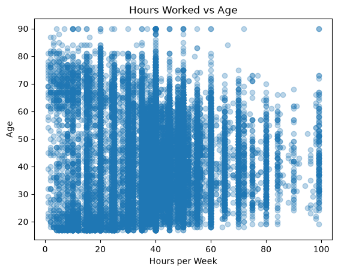

# A Logistic Regression Baseline on the Adult Census Income Data

I took the Adult census income data from OpenML (48,842 rows, 15 columns) and one-hot encoded its categorical columns, then added one engineered feature. On those features I trained a logistic regression to predict whether income is `>50K` or `<=50K`. It scored 84.9% accuracy on the held-out 20% of rows.



*Hours per week against age for all 48,842 rows. Answers bunch up at round numbers, and the densest column sits at 40 hours, the cutoff I used for `long_hours`.*

## What I did

- Loaded the data with `fetch_openml(name="adult", version=2, as_frame=True)` and checked the types and missing counts: six integer columns and nine categorical ones, counting the target `class`.
- Plotted a 20-bin histogram of age and a scatter of hours per week against age before any encoding.
- One-hot encoded all nine categorical columns, target included, with `pd.get_dummies(df, drop_first=True)`. `drop_first` drops one level per category, since that level is implied when the other dummies are all zero.
- Added `long_hours`, a 1/0 flag for more than 40 hours a week, to capture work behavior that may relate to income.
- Split off 20% of the rows with `random_state=42` and fit `LogisticRegression(max_iter=1000)`, with no scaling and no pipeline.

## Results

| Measure | Value |
| --- | --- |
| Rows | 48,842 |
| Raw columns | 15 |
| Columns after encoding, with the target dummy and `long_hours` | 99 |
| Missing values | `workclass` 2,799, `occupation` 2,809, `native-country` 857 |
| Test split | 20% of rows, `random_state=42` |
| Test accuracy | 84.9% (0.8491) |

84.9% is the share of held-out rows where the model picked the right income class. It is the only score in the notebook, so the next version needs a majority-class baseline and precision and recall on the `>50K` class to show how much of that the model earns.

## What I learned

- One fit cannot show whether `long_hours` helped, and it is only a cutoff on `hours-per-week`, which the model already sees. Next time I fit a plain baseline first and report the change.
- Missing values went in as they were. `get_dummies` turned a missing `workclass`, `occupation` or `native-country` into all zeros, which the model cannot tell from the level `drop_first` removed. An explicit missing category would fix that.
- The numeric columns went in unscaled, so `fnlwgt` sits in the hundreds of thousands next to True/False dummies. A scaler inside a pipeline would fix that and keep the test rows out of the fit.

## How to run

```bash
git clone https://github.com/drewmenning/week4-data-exploration-ml.git
cd week4-data-exploration-ml
pip install numpy pandas matplotlib scikit-learn jupyter
jupyter notebook week4_data_exploration_ml.ipynb
```

Run the cells top to bottom. No data is bundled: the first run downloads the Adult data from OpenML through `fetch_openml`, so it needs an internet connection. The saved outputs are from Python 3.13.16.

## Files

- [`week4_data_exploration_ml.ipynb`](week4_data_exploration_ml.ipynb): the notebook, with saved outputs from a clean run on October 14, 2026.
- [`images/age-distribution.png`](images/age-distribution.png): the 20-bin histogram of age.
- [`images/hours-vs-age.png`](images/hours-vs-age.png): the scatter shown above.
- `README.md`: this file.

*Week 4 coursework for Introduction to Machine Learning, AAS in Artificial Intelligence at DMACC, spring 2026.*
