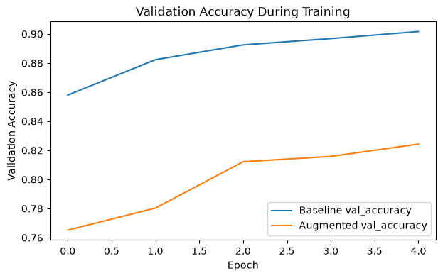
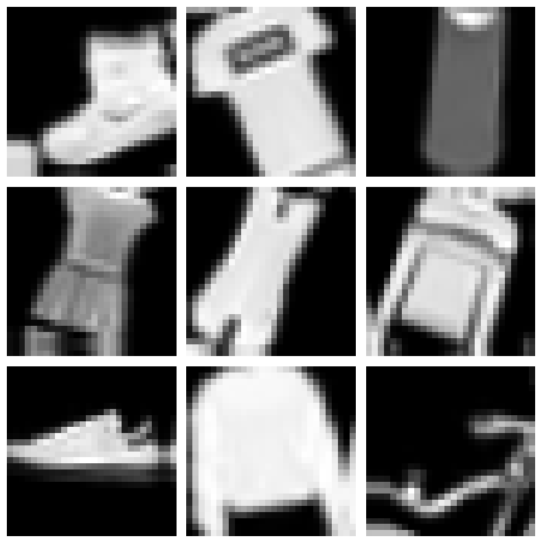

# Data augmentation on Fashion-MNIST: baseline CNN vs. augmented CNN

I trained the same small convolutional network twice on Fashion-MNIST: once on the raw images, and once with random rotation, zoom and translation applied during training. The question was whether augmentation improves generalization. Here it did not: after 5 epochs, test accuracy on the 10,000 held-out images fell from 89.4% for the baseline to 82.1% with augmentation, a drop of 7.3 points. The repo is named after the course module; the work itself is a controlled comparison of two classifiers.



*Validation accuracy over 5 epochs. The baseline is leveling off near 90%, while the augmented model sits lower and is still climbing when training stops.*

## What I did

The two models differ only in whether the augmentation layers are present, so augmentation is the one design change between them.

- **Data.** Fashion-MNIST from the Keras loader: 60,000 training and 10,000 test images, 28x28 grayscale, 10 clothing classes. I divided pixel values by 255 and added a channel axis. 10% of the training images were held out for validation.
- **Baseline.** Two convolution blocks (32 then 64 filters, 3x3 kernels, each followed by 2x2 max pooling) feed a 128-unit dense layer with 0.3 dropout and a 10-class softmax output. That comes to 225,034 parameters. Adam, sparse categorical crossentropy, 5 epochs, batch size 128, seed 42.
- **Augmented.** The same network with three Keras preprocessing layers in front: RandomRotation(0.08), RandomZoom(0.10) and RandomTranslation with height and width factors of 0.08. They sit inside the model, and Keras runs them only in training mode, so validation and test images are scored untouched. The zoom and shift factors are small (10% and 8%). The rotation factor is not: Keras reads 0.08 as a fraction of a full turn, so each image can tilt up to about 29 degrees either way.

## Results

| Model | Training accuracy, epoch 5 | Validation accuracy, epoch 5 | Validation loss, epoch 5 | Test accuracy (10,000 images) | Time per training step, CPU |
|---|---|---|---|---|---|
| Baseline CNN | 89.6% | 90.2% | 0.27 | 89.4% | 19 to 21 ms |
| CNN with augmentation | 80.8% | 82.4% | 0.46 | 82.1% | 27 to 29 ms |

Both models score a little higher on validation than on training at epoch 5. That is expected: dropout, and in the second model augmentation, are active only during training, so training accuracy is measured under harder conditions.

Augmentation cost 7.3 points of test accuracy and made every training step slower. My reading, which I have not proven, has three parts. First, augmentation is a regularizer, and the baseline was not overfitting at 5 epochs (training accuracy 89.6% against validation 90.2%), so there was nothing for it to fix. Second, the rotation is large. Up to about 29 degrees of tilt is variation the centered, upright test images never show. Third, 5 epochs looks too short for the augmented model to absorb the extra variation. Its validation accuracy went 76.5%, 78.0%, 81.2%, 81.6% and 82.4% across the five epochs and had not leveled off when training stopped. The saved outputs come from one top-to-bottom run on October 14, 2026 in a clean environment (Python 3.13, TensorFlow 2.21.0, CPU).



*Nine training images after augmentation. Note the tilt and off-center placement compared with the centered, upright originals the test set is made of.*

## What I learned

- Augmentation is not a free win. It pays off when a model is overfitting and the transformations match variation the model will meet at test time. I do not think either condition held here, so the extra variation acted like noise.
- 5 epochs was not a fair finish line. The augmented validation curve was still rising, so part of the gap may be slower convergence rather than a worse model. Next step: train both models longer and let each one's validation curve decide when to stop.
- One seed, one run each. The seed is set once at the top of the notebook, so the two runs also differ in starting weights and batch order. A 7.3 point gap is big enough that I trust the direction, but I would repeat the runs with several seeds before quoting the exact size.
- I would test each transformation on its own, starting with rotation. In my Module 12 repo the augmentation rotated images by at most 8 degrees, a much smaller tilt, so the rotation size is my first suspect.

## How to run

The second cell downloads Fashion-MNIST through `keras.datasets.fashion_mnist.load_data()`, so there is no data to fetch by hand.

```bash
git clone https://github.com/drewmenning/neural-networks-generative-ai-assignment.git
cd neural-networks-generative-ai-assignment
pip install tensorflow==2.21.0 numpy matplotlib jupyter
jupyter notebook neural_networks_generative_ai_assignment.ipynb
```

Run all cells from the top. On CPU, a baseline epoch took about 8 to 9 seconds and an augmented epoch 12 to 21 seconds. In Colab, TensorFlow is usually already installed, so the pip line can be skipped.

## Files

- [neural_networks_generative_ai_assignment.ipynb](neural_networks_generative_ai_assignment.ipynb): the whole experiment with saved outputs, from loading the data to the printed reflection.
- `images/validation-accuracy.png`: validation accuracy by epoch for both models.
- `images/augmented-samples.png`: nine training images after augmentation.
- `README.md`: this write-up.

*Module 10 coursework (neural networks and generative AI) for the AAS in Artificial Intelligence at DMACC, spring 2026.*
