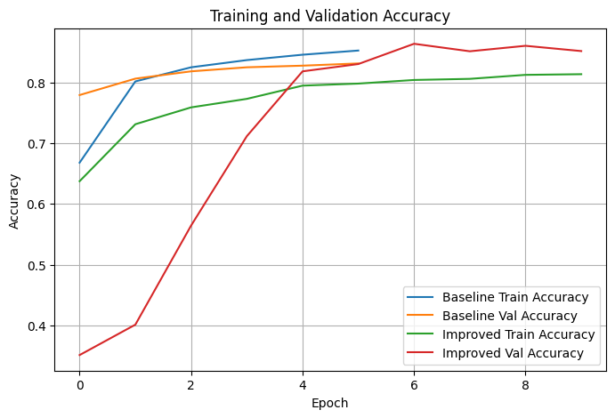
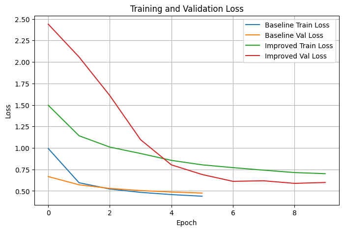

# Fashion-MNIST: Baseline Dense Network vs. Regularized CNN

I trained two image classifiers on a stratified 20,000-image sample of Fashion-MNIST and scored both on the same 3,000 held-out test images. The baseline is a dense network with one hidden layer. The other is a small CNN with L1/L2 penalties, dropout, batch normalization, data augmentation and early stopping. The CNN reached 85.8% test accuracy against 83.9% for the baseline. Its test loss went up, though (0.578 against 0.472), and the training curves did not look the way I expected.



*From epoch 5 on, the CNN's training accuracy runs below its validation accuracy, 81.2% against 86.0% at the restored epoch 9. I first read that as a win, but the training score comes from augmented images with dropout on, so the two curves are not measured alike.*

## What I did

- **Data.** I pooled the Keras training and test sets (70,000 images) and drew a 20,000-image sample stratified by class with `random_state=42`. Two more stratified splits gave 14,000 training, 3,000 validation and 3,000 test images, so every class has exactly 1,400 / 300 / 300.
- **Baseline.** Flatten, Dense(64, ReLU), Dense(10, softmax), trained with Adam and categorical cross-entropy for 6 epochs at batch size 256.
- **Improved model.** Two conv blocks (16 and 32 filters, 3x3, L2 0.001), each with batch norm, 2x2 max pooling and dropout (0.20, then 0.30). On top, Dense(64) with L1 0.0001 plus L2 0.001, batch norm, dropout 0.40 and softmax. It trained on `ImageDataGenerator` batches (up to 8 degrees of rotation, 8% shifts, 8% zoom) at batch size 128 for up to 10 epochs. `EarlyStopping` watched validation loss with patience 2 and `restore_best_weights=True`. Each CNN epoch took about 17 seconds in Colab, against a second or less for the baseline.

## Results

| Model | Validation accuracy | Validation loss | Test accuracy | Test loss |
|---|---|---|---|---|
| Baseline (dense) | 83.1% | 0.475 | 83.9% | 0.472 |
| Improved (CNN) | 86.0% | 0.588 | 85.8% | 0.578 |

Both splits hold 3,000 images. The CNN gains about two points of test accuracy, but its test loss is about 0.1 higher. Part of that is bookkeeping: Keras folds the L1 and L2 penalties into the loss it reports, a term the baseline never pays. The rest, as I read it, is hedging: the regularizers flatten the softmax outputs, and cross-entropy still charges for a right answer made at low confidence. I did not separate the two effects.

Shirt is the weak spot: recall 0.48 on 300 test shirts, with 74 called Pullover, 41 T-shirt/top and 28 Coat. That drags Pullover's precision down to 0.65, along with 60 misread coats. Every class outside the four tops scores F1 of 0.88 or better, and macro F1 is 0.85.



*The CNN's validation loss was 2.06 at epoch 2 and bottomed out at 0.588 in epoch 9, the weights early stopping restored. The baseline's was still falling when its six epochs ran out.*

## What I learned

- The baseline was not overfitting much at six epochs: validation loss fell every epoch, and at epoch 5 training accuracy was 84.5% against 82.7% validation. So the CNN's edge most likely comes from convolutions picking up local shape, not from regularizers I set once and never tuned. I changed both at once, and each model ran once, so the next step is the same CNN without the regularizers, run several times.
- Early stopping never fired: validation loss never worsened two epochs in a row, so all 10 epochs ran. Its real contribution was restoring the epoch 9 weights, which is why the table's validation loss matches epoch 9. Monitoring loss rather than accuracy also decided which epoch was kept: validation accuracy peaked at 86.3% in epoch 7, where validation loss was 0.612, and the restored epoch 9 scored 86.0% at 0.588.
- Most of the leftover error is in the four tops (T-shirt/top, Pullover, Coat, Shirt). At 28x28 grayscale a shirt and a pullover look alike, and I suspect that is a data limit as much as a model limit.

## How to run

The notebook was built in Google Colab on Python 3.11. Fashion-MNIST downloads through `tensorflow.keras.datasets.fashion_mnist.load_data()` on first use, so no data files are bundled.

```bash
pip install tensorflow scikit-learn pandas matplotlib numpy
jupyter notebook m12_assignment.ipynb
```

Run the single code cell top to bottom. Seeds are set to 42, but training is not bit-for-bit repeatable across machines, so expect small differences from the numbers above.

## Files

- [`m12_assignment.ipynb`](m12_assignment.ipynb): the project in one code cell with saved outputs, plus a short reflection cell.
- `images/accuracy-curves.png`: accuracy curves for both models.
- `images/loss-curves.png`: loss curves for both models.
- `README.md`: this file.

*Module 12 coursework for the AAS in Artificial Intelligence at DMACC, spring 2026.*
