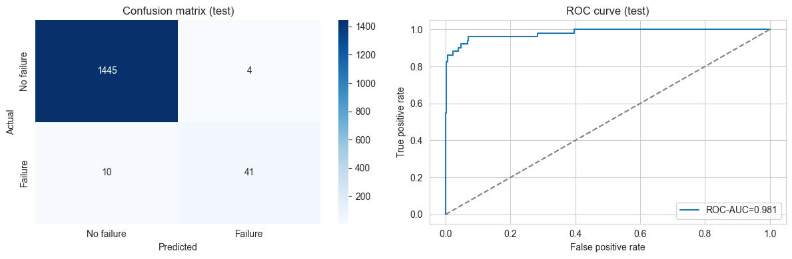
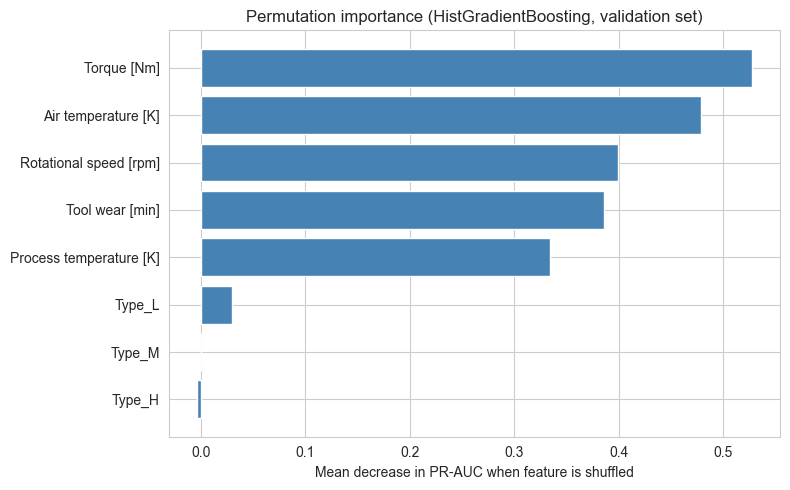

# Machine Failure Prediction on the AI4I 2020 Dataset

I built a binary classifier that flags industrial machines about to fail. It is trained on the AI4I 2020 predictive maintenance dataset from the UCI Machine Learning Repository: synthetic, 10,000 rows, 339 failures, a 3.39% positive rate. The final HistGradientBoosting model, with a threshold tuned on validation data, caught 41 of 51 real failures in the held-out test set with 4 false alarms (recall 0.804, precision 0.911). A fairness check by product quality grade then found a blind spot the overall numbers hide: on Type H machines in validation, the model caught 0 of 4 failures.



*Left: at the tuned threshold, 41 of 51 real test-set failures caught, with 4 false alarms among 1,449 healthy machines. Right: ROC curve on the same test set, ROC-AUC 0.981.*

## What I did

- **Removed the leaks first.** The five per-mode failure flags (TWF, HDF, PWF, OSF, RNF) are the parts the target is built from, so keeping them would leak it. I dropped them and one-hot encoded the product Type (L, M or H), which left 8 features: air temperature, process temperature, rotational speed, torque, tool wear, and the three Type columns. A stratified 70/15/15 split gave 6,999 training rows, 1,501 validation and 1,500 test.
- **Four models, simple to complex.** Logistic Regression and a depth-limited Decision Tree set the floor; Random Forest (300 trees) and HistGradientBoosting are the ensembles. The booster takes its own 15% slice of the training set for early stopping (it stopped at iteration 118), so validation and test stay untouched.
- **Class weights instead of SMOTE.** The first three models use `class_weight='balanced'`. I skipped oversampling because the data is already synthetic, and faking minority rows on top of generated data stacks the same assumptions twice.
- **PR-AUC as the headline metric**, checked with 5-fold stratified cross-validation on the training set. ROC-AUC stays high on imbalanced data because true negatives dominate it; PR-AUC ignores them.
- **Threshold tuned on validation, frozen for test.** I picked the cutoff that maximizes F1 on the validation set (0.496), applied it unchanged to the test set, then checked recall and precision per product Type on validation.

## Results

| Metric (test set, 1,500 rows, threshold 0.496) | HistGradientBoosting |
|---|---|
| Recall (failures caught) | 0.804 (41 of 51) |
| Precision (flags that were real failures) | 0.911 (41 of 45) |
| F1 | 0.854 |
| PR-AUC | 0.882 |
| ROC-AUC | 0.981 |
| Accuracy | 0.991 |

The booster also won the 5-fold cross-validation on PR-AUC with a mean of 0.759 (std 0.026); Random Forest scored 0.675, the Decision Tree 0.594 and Logistic Regression 0.463. At the default 0.5 cutoff on validation the booster had the highest precision (0.882) but the lowest recall of the four (0.588, against 0.824 for the Decision Tree). I picked it on PR-AUC, which rewards ranking failures high, and accepted the lower recall at the default cutoff. On this test set, a maintenance team using the model would inspect 45 machines to catch 41 real failures and miss 10. Whether that trade works depends on failure and inspection costs I did not have. Accuracy of 0.991 flatters the model: always predicting "no failure" scores 96.6% here.



*Mean drop in validation PR-AUC when each feature is shuffled. Torque, air temperature, rotational speed, tool wear and process temperature carry the signal; the product Type columns barely register.*

## What I learned

- **The fairness check surfaced a real problem.** Validation recall was 0.649 on Type L (924 rows) and 0.700 on Type M (459 rows) but 0.000 on Type H (118 rows): 0 of 4 failures caught. H is the smallest grade, so there was little to learn from, and the model barely uses the Type columns anyway. A deployment would need more H failures to train on or an explicit out-of-scope flag for that grade.
- **The metric mattered more than the model.** On validation, ROC-AUC ranged only from 0.840 to 0.951 across the four models, while PR-AUC ranged from 0.308 to 0.765. Logistic Regression looks acceptable by one metric and clearly is not by the other.
- **Threshold tuning did less than I expected.** The F1-max cutoff landed at 0.496, almost exactly the default, so it confirmed the cutoff rather than moved it. A threshold tied to real costs would matter more, since a missed failure costs far more than an extra inspection. I had no cost ratio I could justify on synthetic data.
- **Test recall (0.804) came in well above validation recall (0.608)** at the same cutoff. I have not dug into why. With only 51 failures in the test set, I would not read much into a gap that size either way.
- **The data is synthetic**, so this is a credible result on AI4I, not a guarantee on a real shop floor with sensor noise and timing offsets. Next, in order: real data (NASA C-MAPSS or the PHM Society sets), then a cost-based threshold in place of F1-max. After that, a repair for the Type H blind spot (stratified resampling or a separate H-specific model), and drift checks on the inputs with a recalibration trigger.

## How to run

```bash
git clone https://github.com/drewmenning/ai4i-predictive-maintenance.git
cd ai4i-predictive-maintenance
python -m venv .venv
. .venv/Scripts/activate    # on Windows; use source .venv/bin/activate on Mac/Linux
pip install -r requirements.txt
jupyter notebook predictive_maintenance.ipynb
```

Run all cells top to bottom; the notebook finishes in under two minutes on a laptop. It fetches the AI4I 2020 dataset (UCI id 601) through the `ucimlrepo` package, with a direct CSV fallback, so there is nothing to download by hand. `RANDOM_STATE = 42` fixes the split and the model seeds.

To rebuild the slide deck (python-pptx is not in `requirements.txt`):

```bash
pip install python-pptx
python build_deck.py
```

## Files

- [predictive_maintenance.ipynb](predictive_maintenance.ipynb): the notebook with saved outputs.
- [predictive_maintenance.html](predictive_maintenance.html): HTML export of the executed notebook, for reading the outputs in a browser without running anything.
- `images/`: the two figures used in this README.
- `presentation/`: the seven-slide capstone deck with speaker notes, as [PPTX](presentation/AAI201%20Capstone%20Predictive%20Maintenance%20Drew%20Menning.pptx) and [PDF](presentation/AAI201%20Capstone%20Predictive%20Maintenance%20Drew%20Menning.pdf).
- [build_deck.py](build_deck.py): rebuilds the PowerPoint with python-pptx.
- [requirements.txt](requirements.txt): Python packages for the notebook.

*Capstone project for AAI 201 Machine Learning at DMACC, spring 2026.*
